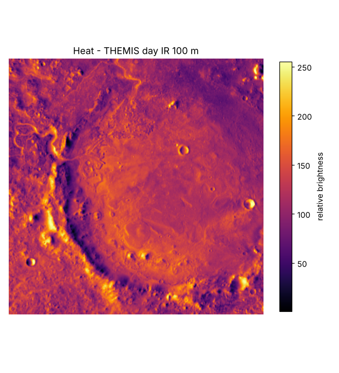

# Heat

**What it is for:** shows how strongly the surface glows in infrared during the day, which hints at what the surface is like.

**What it outputs:** a 100 m per pixel image from the THEMIS camera on Mars Odyssey, clipped to our box. Values run from 1 to 255.

**What it looks like:** a grey image where sun-facing slopes and warm surfaces are bright and shaded or cold surfaces are dark.

**What it tells us:** daytime heat is driven mostly by slope and sunlight, plus how fast the surface heats up: loose sand and dust warm quickly, solid rock more slowly. It helps tell sandy areas from rocky ones.

**Limits:**
- Values are relative brightness, not a calibrated temperature in degrees.
- The mosaic joins images taken at different times and seasons, so seams can show.
- Its map centre is 180° (all other layers use 0°), so it must be reprojected before stacking.
