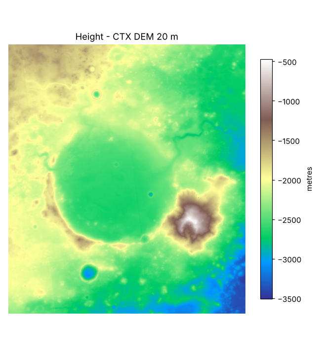

# Height

**What it is for:** shows how high or low every spot in Jezero is. It is the base for slope, hazard and the rover route, and for the 3D terrain.

**What it outputs:** a grid of numbers, one height in metres for every 20 m × 20 m patch (CTX). A coarse 463 m version (MOLA) covers the same box as a backup.

**What it looks like:** a grey image where dark is low and bright is high. The round crater floor is dark; the rim and the hills to the east are bright.

**What it tells us:** the crater floor sits around −2,600 m and the surroundings rise to about −500 m. The river channels that fed the old lake are visible cutting into the western and northern rim.

**Limits:**
- Heights are measured from the Mars "areoid" (a reference shape), not from a sea level.
- The CTX DEM is stitched from several stereo models, so seams and small gaps are possible.
- 20 m pixels cannot show boulders or small rocks that matter to a real rover.
- MOLA (463 m) is too coarse for slope; use it only as background.
