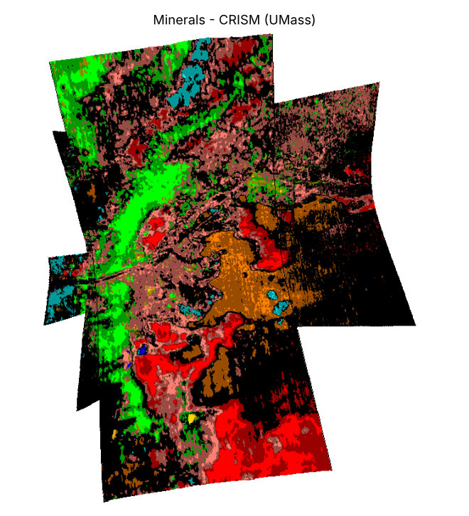

# Minerals

**What it is for:** shows what the rocks are made of, which is the main evidence that Jezero once held a lake.

**What it outputs:** a colour-coded map at 36 m per pixel. Each colour is a mineral class (for example red = olivine, green = Mg-carbonate, cyan = Fe/Mg-smectite clay), bold for high confidence and dull for medium confidence. The full key is in `data/raw/Jezero_readme.pdf`.

**What it looks like:** a small coloured patch over the centre of the crater, with black where no mineral was matched.

**What it tells us:** carbonates and clays form in water, so finding them on the delta and crater floor supports the ancient-lake story. These are also targets a rover would want to reach.

**Limits:**
- Covers only the landing area (18.28–18.74 °N, 77.27–77.64 °E), not the whole box.
- Mineral names are the closest match to known spectra, not confirmed identifications.
- Made from four CRISM images; dust cover can hide minerals underneath.
