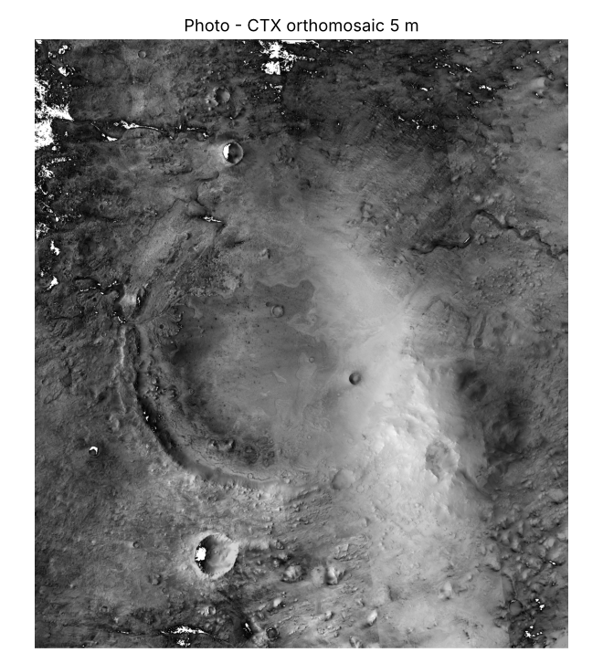

# Photo

**What it is for:** gives users a real picture of the ground so the other layers make sense. It is the backdrop of the map.

**What it outputs:** a black-and-white image at 5 m per pixel from the CTX camera on the Mars Reconnaissance Orbiter, lined up exactly with the CTX height map.

**What it looks like:** a detailed grey photo of the crater, its rim, small craters, and the fan-shaped delta on the western side.

**What it tells us:** where the visible landforms are: the delta, channels, crater rims and dune fields. It helps users find their way and check that other layers sit in the right place.

**Limits:**
- Brightness depends on sunlight when the image was taken, not on what the ground is made of.
- It is stitched from several images, so brightness can change across seams.
- No NoData is stored in the file; black edges (value 0) must be hidden by the app.
