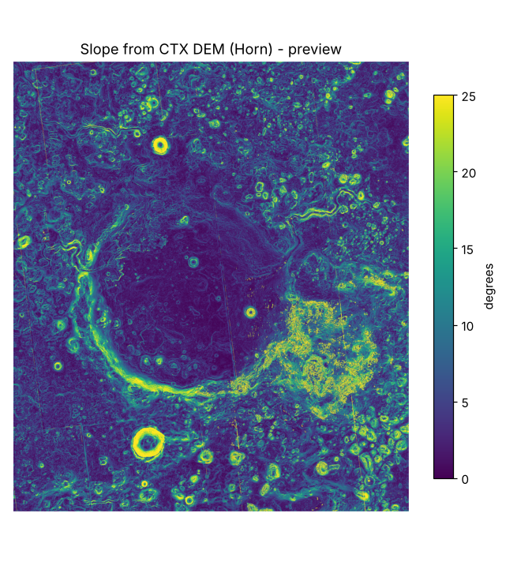

# Slope

*Preview computed by Sadia from the CTX DEM; Maheen's `derive.py` produces the official `slope.tif`. Faint straight lines in the image are DEM stitching seams.*

**What it is for:** shows how steep the ground is, which decides where a rover can and cannot drive. It feeds the hazard classes and the route cost grid.

**What it outputs:** a grid of slope angles in degrees, one per 20 m pixel, calculated from the CTX height map with the Horn method (`data/processed/slope.tif`, made by the pipeline).

**What it looks like:** flat areas dark, steep areas bright. Crater rims, channel walls and small crater edges stand out as bright lines and rings.

**What it tells us:** in our preview about 8% of the box is steeper than 15°. The crater floor is mostly gentle and drivable. The rim, the delta front and channel walls are steep. Ground above 15° is treated as too steep for the rover.

**Limits:**
- Only as good as the height map: DEM seams can create false steep spots.
- At 20 m it averages out short, steep features such as boulders or small scarps.
- The 15° limit is a team assumption based on rover guidance, not a measured value for this terrain.
