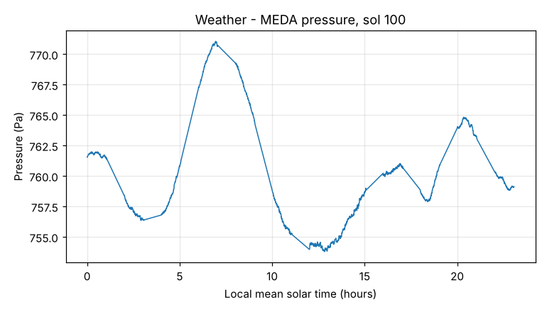

# Weather

**What it is for:** gives real measurements from the surface, taken by the Perseverance rover itself, so the app is grounded in what conditions are actually like at Jezero.

**What it outputs:** tables (CSV), about one reading per second for three Mars days (sols 100, 101, 102): air pressure (Pa), relative humidity, humidity-sensor temperature (K), infrared radiation from the sky and ground (W/m²), and wind speed (m/s) and direction (degrees).

**What it looks like:** not a map. Best shown as a line chart over one sol, for example pressure rising and falling through the day.

**What it tells us:** air pressure is about 760 Pa, less than 1% of Earth's. Conditions swing strongly between day and night, and wind changes through the sol. These shape when and how a rover can work.

**Limits:**
- The sensors do not run all sol, so there are gaps (the straight segments in the chart).
- Measured at one spot (wherever the rover was), not across the crater.
- Only three sols, so it shows one season, not a year.
- Missing values appear as 999999999 or blank cells.
- The TIRS files hold infrared radiation, not ground temperature.
